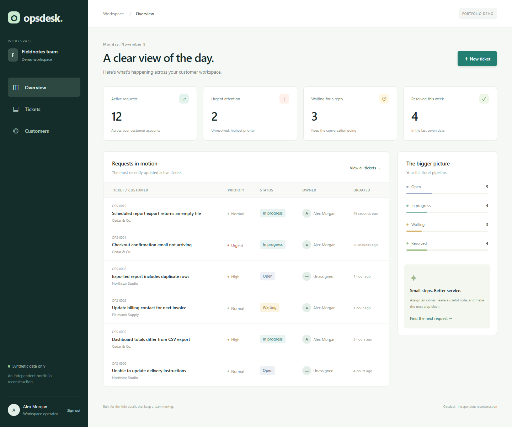
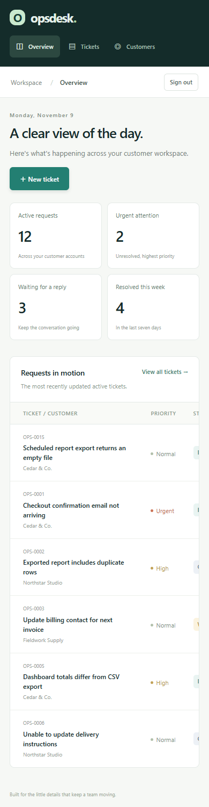
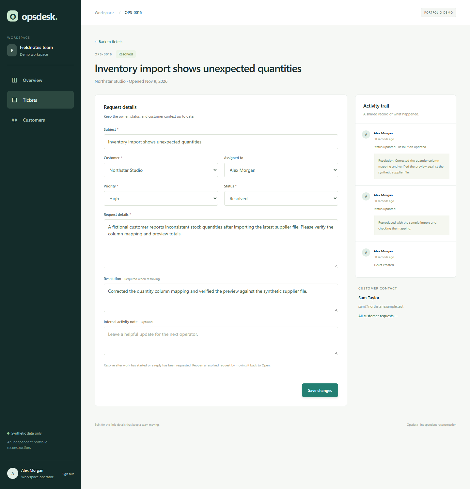

# Opsdesk - Laravel admin reconstruction

A runnable customer operations portal with a shared ticket inbox, customer directory, dashboard, assignment, and a validated ticket lifecycle.

## Provenance and dates

**Resume-reported context: LET'S DO YOUR PLAN PTE. LTD., August 2023-March 2026.**

That period describes the employment context supplied for this exercise. This repository is a **new, independent reconstruction created in November 2026**, inspired by the resume's generic Laravel backend and administrative interface responsibilities. It is not recovered company source code, an official employer product, evidence of an individual's historical contributions, or a reproduction of a named client's implementation. Individual client assignments remain unverified. Git history records the actual work dates.

All customer names, contacts, tickets, and operators are synthetic. Relative dates in the seed data are demo fixtures, not historical project dates.

## What works

- Session sign-in and sign-out with CSRF protection, password hashing, session rotation, and login rate limiting.
- Dashboard showing active, urgent, waiting, and recently resolved requests.
- Search by subject, customer name, or ticket reference, plus combined status/priority/owner/customer filters and pagination.
- Create and update requests with server-side field and foreign-key validation.
- Assign an operator, change priority, and leave an internal note.
- Enforced transitions: Open -> In progress / Waiting; In progress -> Waiting; In progress / Waiting -> Resolved; Resolved -> Open.
- Starting work or resolving requires an owner; resolving also requires a resolution.
- Transactional activity history with actor attribution; resolution text remains in history after reopening.
- Optimistic version checks reject stale edits and require reloading the current revision.
- A responsive Blade interface with accessible labels, focus states, empty states, and escaped customer content.

## Screenshots

Mobile dashboard and resolved ticket workflow

## Workbook roadmap

Read the [simulation roadmap and feature-to-source map](docs/simulation-roadmap.md) derived from `portfolio_daily_activity_simulation_2023_2026.xlsx`. Its dates and slot counts are hypothetical planning data. Commits retain their actual creation dates.

## Run locally

Use PHP 8.5 (tested with **PHP 8.5.12**) and Composer 2. Required extensions include ctype, curl, dom, fileinfo, filter, hash, intl, mbstring, openssl, pdo_sqlite, session, tokenizer, xml, and zip. The committed lock file includes Symfony dependencies requiring PHP 8.4.1 or later; PHP 8.5 is the recommended environment.

No Node, external API, paid service, or frontend build is required. SQLite stores data on disk.

~~~sh
composer run setup
composer run dev
~~~

Open **http://127.0.0.1:8063**.

Default local demo login:

- Email: **demo@example.test**
- Password: **opsdesk-demo-2026**

The second synthetic operator is Casey Rivera (casey@example.test), using the same default demo password.

The setup script installs the locked packages, creates .env if absent, generates a local application key, creates the SQLite file, migrates, and seeds four fictional customers and fourteen requests. Re-running the seeder preserves existing tickets and accounts. Change DEMO_PASSWORD in .env **before the first seed** to choose a different initial password; changing it later does not reset existing users.

For manual setup:

~~~sh
composer install
php -r "file_exists('.env') || copy('.env.example', '.env');"
php artisan key:generate
php -r "file_exists('database/database.sqlite') || touch('database/database.sqlite');"
php artisan migrate --seed
php artisan serve --host=127.0.0.1 --port=8063
~~~

On Windows, enable the needed extensions in php.ini. A portable PHP executable and composer.phar can be used in place of globally installed commands; these machine-specific tools are intentionally excluded from this repository.

## Verify

~~~sh
composer validate --strict
composer test
php vendor/bin/pint --format agent
~~~

The test suite uses an in-memory SQLite database, separate from the local demo data. It covers authentication and rate limits, persisted requests, validation failures, transition/assignment/resolution rules, reopen behavior, audit attribution, conflicting updates, conflict-page behavior, combined search filters, pagination, dashboard counts, escaping, and missing resources.

Local verification on November 9, 2026: **14 tests, 97 assertions passed**, migrations/seeding and Blade compilation passed, and a real HTTP cookie/CSRF flow verified sign-in, create/update, all main pages, and stale-edit handling. The included GitHub Actions workflow will run after publication; this README does not claim a remote CI result.

Isolated headless Chrome browser QA also passed: desktop login, ticket creation, assignment and priority, starting work, resolution persistence, mobile layout without document overflow, and mobile sign-out. No browser JavaScript errors were observed. Screenshots contain only synthetic demo data.

## Design and boundaries

Laravel 13, PHP enums, Eloquent relationships, Form Requests, a transactional TicketWorkflow service, SQLite migrations, Blade, and local CSS. State rules live in the service rather than relying on dropdown options.

This is a trusted-local demonstration. All signed-in operators share one workspace and can edit all requests. It has no tenant isolation, role administration, customer self-service login, email sending, file attachments, billing integration, or password-reset flow. Customers are seeded and read-only in this version. The publicly documented demo credentials are not suitable for deployment; replace the demo access model and review deployment settings before exposing the app.

No employer/client data, external credentials, or resume PDF is bundled. .env, application keys, SQLite files, dependencies, logs, sessions, and generated views are ignored.

## License and framework attribution

Application code is MIT licensed; see LICENSE. The application starts from the official laravel/laravel skeleton. Laravel framework copyright and MIT terms are retained in its distributed dependency license. Third-party packages retain their respective licenses.
